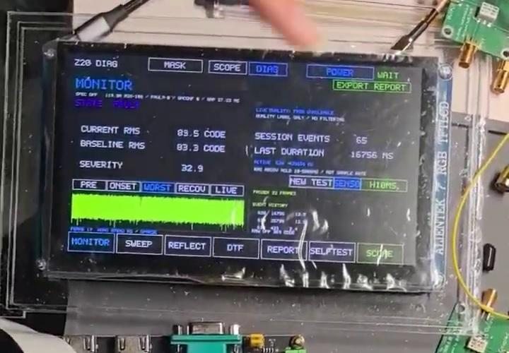
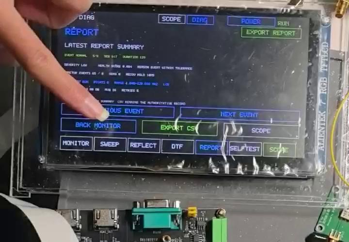

# Coax Link Analyzer｜便携式同轴链路智能诊断仪

[](https://github.com/zczczzc431/coax-link-analyzer/actions/workflows/ci.yml)
[](LICENSE)

**面向射频回路线缆的状态检测与间歇故障留证，基于 Zynq-7000、FPGA 高速采集与嵌入式 Linux。**

同轴连接器松动、线缆受力和接触不良，往往表现为难以复现的短时异常。本项目将可控测试激励、正常参考学习、时频分析和事件记录组合起来，把“偶尔看见波形不对”转化为可以回查、比较和导出的故障证据。

This repository contains the original application software, selected FPGA data-path RTL, and isolated DDC research sources for a portable coaxial-link diagnostic prototype. See [README.en.md](README.en.md) for an English overview.

## 主要工作与创新

- **面向线缆排障的闭环流程**：将主动激励、响应采集、参考学习、异常判定和报告组织为一套测试流程。
- **时频多特征联合判断**：结合幅度、频率与 FFT 频谱 MASK，补充仅凭 RMS 难以发现的谱形变化。
- **异常关键帧与事件留证**：关联 PRE、ONSET、WORST、RECOV 和 LIVE，记录事件次数、持续时间及异常程度，支持 CSV 导出与复核。
- **嵌入式多模式集成**：在同一触控界面提供 SCOPE、FFT、GEN、MONITOR、SWEEP、手动 REFLECT 与报告入口。
- **可审计的异步存储**：区分已排队与已持久化证据，包含索引、完整性核验、存储故障注入和退出保存回归。





*截图来自团队提供的展示视频，用于说明界面；不作为本次发布新增模拟性能测试的证据。*

## 发布状态

这是 **研究原型的源码首发快照**，并非可直接刷入任意同型号板卡的固件发行版。

| 部分 | 本仓库提供内容 | 状态与边界 |
|---|---|---|
| Linux 应用 | 699 r2 冻结输入中的正式应用及依赖 | 有历史实板与冷启动记录；本次 CI 验证编译和离线回归 |
| MONITOR / MASK / 报告 | 参考学习、判定、关键帧、异步证据存储 | 保留真实配置语义；HOLD 是恢复保持时间，不是采样周期 |
| SCOPE / FFT | 波形交互、统计、FFT、游标与触发配置 | 频率读数、FFT 栅格和 RBW 是不同指标 |
| SWEEP / REFLECT | 软件流程、计算、会话与导出模块 | REFLECT 为耦合器两阶段分时测量；不是完整校准 VNA 或 DTF |
| 采集与触发 RTL | 原创帧缓存、触发环、邮箱、跨域桥及链路监测模块 | 是可复用模块集合；不包含完整厂商板级工程 |
| GEN 参考数据通路 | 历史 400 MSPS 双样点发生器、波表、测试平台与匹配 CLI 源码 | 参考版本，不等同于当前稳定位流的全部 ROM ECO 与最新硬件签核 |
| CUSTOM / AWG | 公式引擎、波形包、预览与受保护后端事务 | 不宣称任意波形模拟输出已经验收 |
| 1 kHz RBW | `experiments/ddc765` 的 DDC、滤波、抽取和冻结缓存候选 | 有历史隔离仿真与 OOC 时序记录；未完成整机真实频谱验收 |

**当前硬件问题公开说明**：更换载板/子卡后的 DAC 支路仍存在初始化与 SPI 回读异常，目标信号发生功能尚未恢复。已停止硬件修复尝试；不能凭 PLL 绿灯、命令发送成功或软件编译通过认定 DAC 输出正常。详情见 [功能状态与已知问题](docs/STATUS.md)。

## 快速开始：离线构建与测试

环境：Linux、Python 3.8+、GCC、pthread/libm；可选 ARM 交叉编译器和 Icarus Verilog。

```bash
git clone https://github.com/zczczzc431/coax-link-analyzer.git
cd coax-link-analyzer
python3 tools/audit_release.py
python3 tools/build.py test
python3 tools/build.py app
```

`test` 运行合成输入或隔离临时目录中的算法/存储/UI 辅助函数回归，不访问板卡。`app` 只编译，**不会执行、安装或设置开机自启**。

```bash
# 可选：ARM 编译（仍不运行）
python3 tools/build.py app --cc arm-linux-gnueabihf-gcc
# 可选：ADC 模块展开与历史 DAC 参考仿真
python3 tools/build.py rtl-test
```

完整要求见 [构建说明](docs/BUILD.md)。本仓库没有“一键刷卡”或“一键上板”脚本。

## 目录

```text
software/app/             正式应用依赖闭包与精选已有回归
software/reference/       历史 400 MSPS 合同匹配的 dacctl 源码
fpga/rtl/adc/             原创采集、触发、跨域与事件模块
fpga/reference/dac400/    历史双样点 DAC 数据通路与数字仿真
experiments/ddc765/       隔离 DDC/滤波/抽取/冻结缓存实验
docs/                    架构、硬件、状态、构建和来源清单
tools/                   离线构建与公开包检查
.github/workflows/       GitHub Actions 离线验证
```

## 架构与硬件

```text
测试激励 → 被测同轴链路 → ADC → FPGA 缓存/触发 → PS Linux
                                                 ├─ SCOPE / FFT
                                                 ├─ MONITOR / 参考学习
                                                 └─ 关键帧 / CSV / 报告
可选定向耦合器 → 分时 Forward / Reverse → 相对反射分析
```

开发平台为 Z20 / XC7Z020-2、FMCADDA-5474-9142、ADS5474、AD9142A、AD9516-3 和 800×480 触控 LCD。详情见 [硬件与接口](docs/HARDWARE.md) 和 [架构](docs/ARCHITECTURE.md)。

厂商 Vivado IP、板卡原理图、LCD BSP、Linux/启动镜像和厂商 SPI/SelectIO 例程未随本仓库再分发。**因此这个源码包不能独立重建已验证的整机稳定位流或 SD 系统。**

## 参与与许可

欢迎提交可离线复现的问题、测试与改进；请注明软硬件版本、输入条件、预期结果和实际结果，勿提交密码或含私有信息的原始日志。

原创发布内容采用 [MIT](LICENSE)。外部依赖仍适用各自许可证，见 [第三方依赖说明](THIRD_PARTY_NOTICES.md)。
